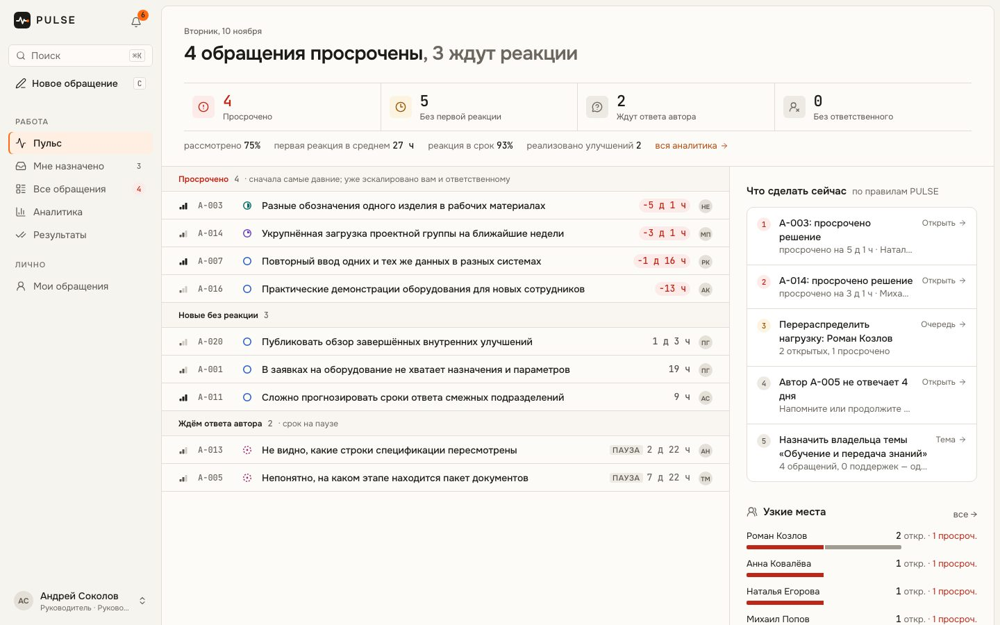
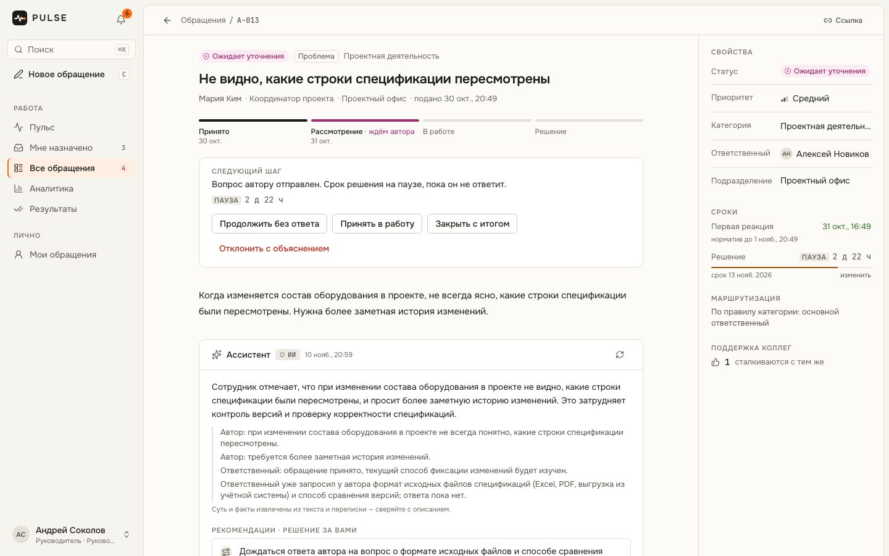
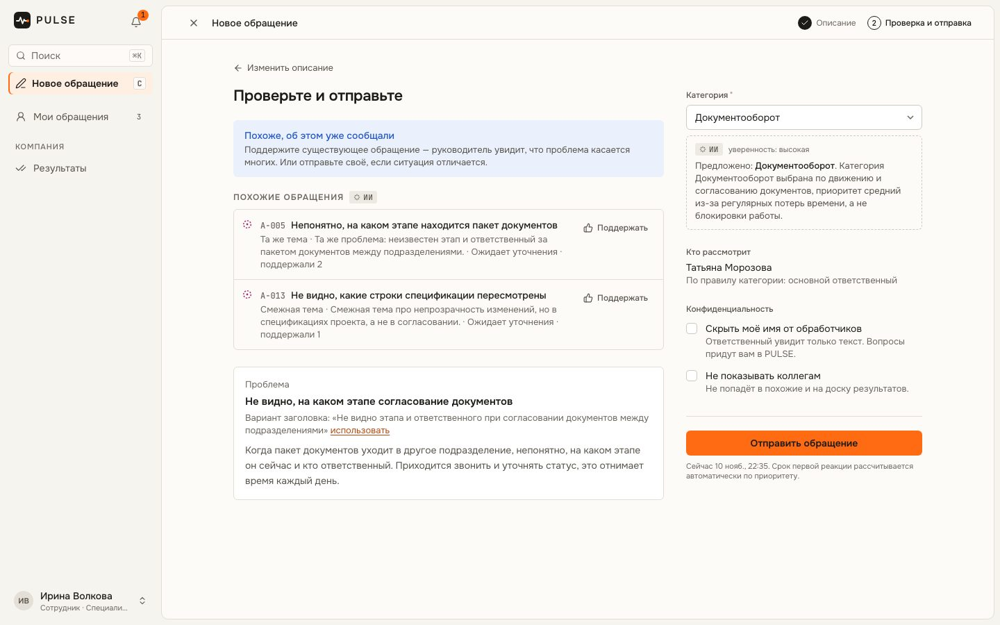

# PULSE

**Платформа обратной связи и предложений сотрудников.**
*Every voice moves us forward.*

## Overview

PULSE — единый канал, через который сотрудники сообщают о проблемах и предлагают улучшения. Каждое обращение сразу получает ответственного, срок реакции и обязательный итог: решение или мотивированный отказ. Автор видит ход рассмотрения. Руководство видит просрочки, нагрузку и повторяющиеся проблемы.

Разработан для хакатона ГК «Модус Трейд» как работающий MVP.

## Features

- **Подача обращения за минуту.** Ассистент подбирает категорию и показывает похожие обращения: вместо дубля можно поддержать существующее. Имя автора можно скрыть.
- **Маршрутизация без потерь.** Ответственный назначается по правилам категории. Если он отсутствует — резервный, затем руководитель подразделения автора.
- **Сроки и эскалации.** Срок первой реакции и решения по приоритету, просроченные обращения эскалируются автоматически.
- **Прозрачный процесс.** Ход рассмотрения, уточнения у автора, история действий. Отказ без обоснования невозможен.
- **Пульс руководителя.** Что просрочено, что сделать сейчас, у кого узкое место, какие проблемы повторяются.
- **Аналитика и сводка для руководства.** Метрики сроков и результатов, системные проблемы с рекомендациями.
- **Системные решения.** Повторяющуюся тему можно решить целиком: одно решение переводит все её обращения, назначает владельца темы и уведомляет каждого автора и поддержавшего.
- **AI с подтверждением человеком.** Разбор обращения и сводка на Claude. Без ключа работают локальные алгоритмы.
- **Роли и доступ.** Сотрудник, ответственный, руководитель, администратор. Права проверяются на сервере.
- **Битрикс24.** Новые обращения, переназначения, просрочки, решения и системные решения по темам приходят в рабочий чат команды. Сводку для руководства можно отправить туда же одной кнопкой.

## Screenshots

**Пульс руководителя**



**Карточка обращения с ассистентом**



**Подача обращения: категория и похожие обращения**



## Tech Stack

Next.js 16 · React 19 · TypeScript · PostgreSQL · Prisma · Tailwind CSS · TanStack Query · Anthropic SDK (Claude) · Vitest · Playwright

## Quick Start

Нужны Node.js 22+ и PostgreSQL 15+. Если PostgreSQL не установлен, его можно поднять командой `docker compose up -d`.

```bash
npm install
```

```bash
cp .env.example .env.local
```

В `.env.local` укажите `DATABASE_URL` и `SESSION_SECRET`. Секрет можно сгенерировать так: `openssl rand -base64 48`. `ANTHROPIC_API_KEY` и настройки Битрикс24 необязательны.

```bash
npm run setup
```

Эта команда применяет миграции и загружает демо-данные.

```bash
npm run dev
```

Приложение откроется на http://localhost:3000.

Проверки: `npm test`, `npm run test:integration`, `npm run test:e2e`.

## Demo Access

На странице входа есть быстрый вход под каждой ролью. Пароль для всех аккаунтов — `pulse-demo`.

- Сотрудник — `employee@pulse.demo`
- Ответственный — `handler@pulse.demo`
- Руководитель — `manager@pulse.demo`
- Администратор — `admin@pulse.demo`

Демо-данные — 20 синтетических обращений из датасета хакатона. Имена пользователей вымышлены.

## Deployment

PULSE — обычное Next.js-приложение с PostgreSQL: работает на VPS (`npm run build && npm start`) и на Vercel.

- **База.** Миграции: `npm run db:deploy` (переменные берутся из окружения, `.env.local` не обязателен). Демо-данные: `npm run db:seed` — **полностью очищает базу**; если в ней есть пользователи не из демо-набора, seed остановится (принудительно — `SEED_FORCE=1`). Пароль демо-аккаунтов можно задать: `SEED_PASSWORD="…"`.
- **Serverless (Vercel).** Используйте пул соединений провайдера (Neon, Supabase): в `DATABASE_URL` — адрес пула с `?pgbouncer=true&connection_limit=1`; миграции запускайте по прямому адресу базы. Файлы вложений хранятся в PostgreSQL, отдельное хранилище не нужно. Тело запроса на Vercel ограничено 4,5 МБ — файлы крупнее не загрузятся (на VPS лимит 10 МБ).
- **Эскалации по расписанию.** `GET /api/cron/sla` с заголовком `Authorization: Bearer $CRON_SECRET` (формат Vercel Cron) или `POST` с `x-cron-secret`. Без планировщика эскалации срабатывают при открытии очереди, пульса и аналитики.
- **Обратный прокси (nginx).** Передавайте `Host` (`proxy_set_header Host $host;`) или задайте `PULSE_PUBLIC_URL` — иначе защита от CSRF отклонит изменения. `TRUST_PROXY=true` — только если прокси выставляет `X-Forwarded-For`. Нужен HTTPS: cookie сессии в production помечена `Secure`.
- **Публичный стенд.** `DEMO_MODE=true` показывает быстрый вход и пароль демо-аккаунтов, включая администратора. Для стенда, доступного не только жюри, — `DEMO_MODE=false` и свой `SEED_PASSWORD`.

## Documentation

- [Продуктовая концепция](docs/PRODUCT.md) — проблема, пользователи, сценарии, MVP, KPI, план развития
- [Архитектура](docs/ARCHITECTURE.md) — компоненты, данные, API, безопасность, AI
