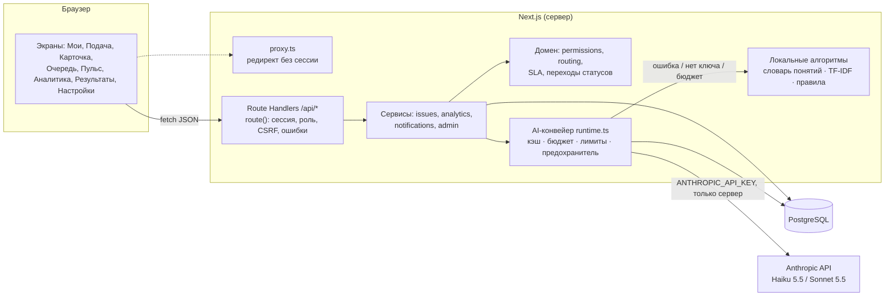
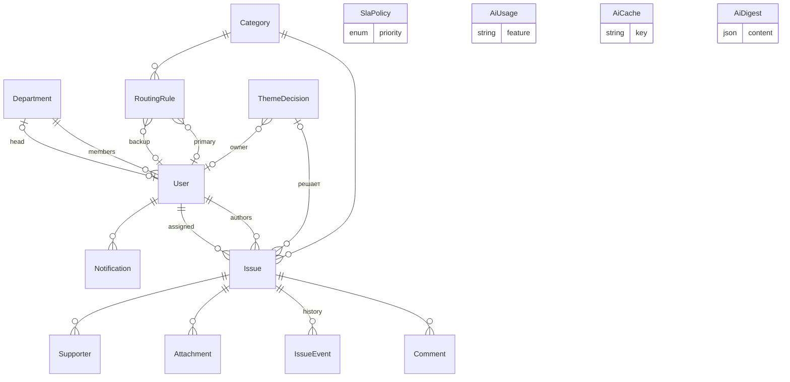

# PULSE — архитектура

## 1. Стек и обоснование

| Слой | Выбор | Почему |
|---|---|---|
| Приложение | **Next.js 16** (App Router, Turbopack), React 19, TypeScript strict | Одно приложение — и интерфейс, и серверный API. Для хакатона и первого пилота микросервисы не нужны |
| БД | **PostgreSQL** + **Prisma 6.19** | Реляционная модель (обращения, история, права), транзакции, миграции. Prisma 6 — стабильная ветка (7/8 на момент разработки были RC) |
| Данные на клиенте | TanStack Query | Кэш, фоновое обновление очереди, инвалидация после действий |
| UI | Tailwind CSS 4, Radix UI (примитивы), cmdk, Recharts, lucide | Собственная дизайн-система на токенах; Radix даёт доступность диалогов и меню |
| Аутентификация | JWT (HS256, `jose`) в httpOnly-cookie, bcrypt | Простая и прозрачная для демо; заменяется на SSO без изменения API |
| Валидация | Zod 4 | Одни схемы для API и структурированных ответов AI |
| AI | **Официальный Anthropic SDK** (`@anthropic-ai/sdk`), structured outputs | См. раздел 6 |
| Тесты | Vitest (unit, интеграционные), Playwright (E2E) | |

## 2. Компоненты



Права проверяются **в каждом серверном обработчике** (`issueAccess()` + `route({ roles })`), а не только в интерфейсе. `proxy.ts` — лишь оптимистичный редирект неавторизованных.

## 3. Модель данных



Ключевые решения:
- **`Issue`** хранит оба срока (`firstResponseDueAt`, `dueAt`), отметки `firstResponseAt` и `resolvedAt` (для метрик), `routingNote` (объяснение маршрута), `escalatedAt` (эскалация однократная), кэш AI-разбора (`aiTriage` + хэш входа).
- **`ThemeDecision`** — системное решение по теме: название, текст, исход, владелец темы, кто принял, сколько сотрудников уведомлено. Обращения ссылаются на него через `Issue.themeDecisionId`.
- **`IssueEvent`** — неизменяемая история: создание, маршрутизация, назначения, статусы, решения, эскалации. Поле `internal` скрывает событие от автора.
- **`Comment.kind`**: `COMMENT` (виден автору), `INTERNAL`, `INFO_REQUEST`, `INFO_RESPONSE`.
- **`RoutingRule`**: уникальность `(categoryId, issueType)`. Правило с `issueType = null` — по умолчанию, с типом — переопределение (отзывы → HR). Режим `AUTHOR_DEPARTMENT_HEAD` направляет обращение руководителю подразделения автора.
- **`AiUsage`** — журнал вызовов с токенами, стоимостью, исходом (`ai`, `cache`, `fallback`, `blocked`, `error`). По нему считается бюджет.
- Код обращения `A-NNN` продолжает нумерацию датасета.

## 4. API

Все ответы JSON. Ошибки в едином формате `{ error: { message, code, details } }`, сообщения на русском.

| Метод | Путь | Кто | Назначение |
|---|---|---|---|
| POST | `/api/auth/login`, `/api/auth/logout` | все | Вход и выход. Лимит неудачных попыток: 8 за 5 мин на IP+email |
| GET | `/api/me` | авторизованные | Пользователь, счётчики, непрочитанные |
| GET | `/api/meta` | авторизованные | Категории, подразделения, обработчики, нормативы |
| GET | `/api/issues?view=&status=&type=&categoryId=&departmentId=&assignee=&priority=&q=&sort=&code=` | авторизованные | Список в пределах прав; `code` (можно несколько) — точный набор обращений |
| POST | `/api/issues` | авторизованные | Создание + маршрутизация |
| GET / PATCH | `/api/issues/:code` | по правам | Карточка с учётом уровня доступа / изменение статуса, приоритета, категории, ответственного, срока |
| POST | `/api/issues/:code/comments` | автор, обработчик | Ответ, заметка, ответ на уточнение |
| POST | `/api/issues/:code/support` | сотрудники | Поддержать / снять поддержку |
| POST | `/api/issues/:code/attachments` | автор, обработчик | Загрузка файлов (multipart) |
| GET / POST | `/api/issues/:code/triage` | обработчик | AI-разбор: из кэша / сформировать |
| GET | `/api/attachments/:id` | автор, обработчик | Скачивание с проверкой прав |
| GET / POST | `/api/notifications` | авторизованные | Список / отметить прочитанными |
| GET | `/api/analytics?period=&departmentId=&categoryId=` | HANDLER+ | Метрики |
| GET | `/api/results` | авторизованные | Доска результатов (без авторов и приватных) |
| POST | `/api/ai/assist` | авторизованные | Помощник подачи |
| GET / POST | `/api/ai/digest` | HANDLER+ / MANAGER+ | Сводка для руководства |
| * | `/api/admin/*` | ADMIN | Категории, правила, пользователи, SLA, AI |
| POST | `/api/ai/digest/share` | MANAGER+ | Отправить последнюю сводку в чат Битрикс24 |
| POST | `/api/themes` | MANAGER+ | Системное решение по теме: перевод всех обращений, уведомления, сообщение в Б24 |
| GET | `/api/admin/integrations` | ADMIN | Статус Битрикс24 (адрес вебхука маскирован) |
| POST | `/api/admin/integrations/bitrix24/test` | ADMIN | Тестовое сообщение в чат Битрикс24 |
| GET / POST | `/api/cron/sla` | `Authorization: Bearer` (Vercel Cron) / `x-cron-secret` | Эскалации по расписанию |

## 5. Безопасность

- **Секреты** только в переменных окружения. `.env*` в `.gitignore`, в репозитории — `.env.example`. `ANTHROPIC_API_KEY` используется только в серверном модуле (`import "server-only"`).
- **Сессия** — подписанный JWT в httpOnly, SameSite=Lax cookie, Secure в production, срок 10 часов. При каждом запросе пользователь перечитывается из БД: деактивация действует сразу.
- **CSRF** — мутирующие запросы (включая вход и выход) с чужим `Origin` или `Sec-Fetch-Site: cross-site` отклоняются (403).
- **Перебор паролей** — 8 неудачных попыток за 5 минут на пару IP + email и 30 на email с любых адресов. `X-Forwarded-For` и `X-Real-IP` учитываются только при `TRUST_PROXY=true` (на Vercel — автоматически). Время ответа выравнивается для несуществующих email. Защита от открытого редиректа (`safeNext`). Пароль демо-аккаунтов попадает в браузер только при `DEMO_MODE=true`.
- **Целостность данных** — любое изменение обращения с оптимистичной проверкой (409 при параллельном изменении). Ответ автора на уточнение меняет статус только если обращение всё ещё ждёт ответа. Эскалации атомарны и идемпотентны. Срок решения отодвигает только руководитель: ответственный, понизив приоритет, срок не продлевает. Закрытое обращение не редактируется без переоткрытия; при переоткрытии срок отсчитывается заново. При деактивации или снятии роли обработчика открытые обращения перемаршрутизируются; если ответственного нет — уведомляются руководители. Последнего администратора нельзя понизить или отключить.
- **Авторизация** на сервере для каждого объекта. Недоступное обращение отвечает 404, а не 403, чтобы не раскрывать факт существования.
- **Валидация** всех входных данных (Zod), ограничения длины, очистка нулевых байтов.
- **Файлы:** белый список MIME, проверка сигнатуры содержимого, лимит 10 МБ и 5 файлов (проверяется в транзакции с блокировкой обращения), запрос без `Content-Length` отклоняется. Содержимое хранится в PostgreSQL (таблица `FileBlob`) — работает на serverless-хостинге без диска; выдача только через API с `Content-Disposition: attachment` и `nosniff`.
- **Заголовки:** `X-Frame-Options: DENY`, `nosniff`, `Referrer-Policy`, `Permissions-Policy`, HSTS. Размер JSON-тела запроса ограничен 256 КБ.
- **Битрикс24:** квадратные скобки в пользовательском и AI-тексте заменяются, поэтому текст никогда не становится BB-кодом (ссылки, упоминания, кнопки). На Vercel отправка продлевается через `after()`.
- **Пароли** — bcrypt; защита от подбора.
- **Персональные данные в AI:** не передаются имена и email, анонимные авторы без подразделения, маскирование email и телефонов в тексте.
- **Анонимность в API:** у анонимных обращений не отдаются автор, его подразделение и user id в истории. Фильтр по подразделению их исключает. Маршрут минует руководителя подразделения автора и никогда не назначает ответственным самого автора. В списке «Вы поддержали» автор и подразделение не показываются (как и в карточке).
- **Конфиденциальные обращения** не попадают в похожие (в том числе в AI-разбор ответственного), на доску результатов и в сообщения Битрикс24; в системном решении их коды не перечисляются. В сводку для чата не уходят проблемы, в которых есть конфиденциальное обращение.
- **Аналитика по правам:** ответственный видит метрики только по своим обращениям; сводка для руководства — только руководителю и администратору.

## 6. Интеграция с Битрикс24

Модуль `src/lib/integrations/bitrix24.ts`. Ключевые события сервиса обращений (создание, переназначение, эскалация, ответ автора на уточнение, решение, системное решение по теме) после успешной записи в БД ставятся в очередь и отправляются в групповой чат методом `im.message.add` через входящий вебхук.

- **Не блокирует PULSE:** отправка в фоне, по одному сообщению (лимит портала ~2 запроса/с), таймаут 5 с, один повтор при сетевой ошибке, 5xx или `QUERY_LIMIT_EXCEEDED`. Ошибки Б24 переводятся в понятные причины и показываются в «Настройки → Интеграции».
- **Безопасность:** адрес вебхука содержит секрет — он только в переменных окружения сервера, в интерфейсе маскируется. Принимается только `https://…/rest/<id>/<код>/`. BB-коды из пользовательского текста вычищаются, чтобы текст не превращался в ссылки или упоминания.
- **Приватность:** имена авторов не передаются; у конфиденциальных обращений — только код и ссылка.
- **Сводка по кнопке:** `POST /api/ai/digest/share` отправляет последнюю сводку (заголовок, до трёх системных проблем с кодами и рекомендациями) и ждёт ответа портала, чтобы показать руководителю результат. Проблемы, собранные только из конфиденциальных обращений, не отправляются, коды конфиденциальных обращений из остальных убираются.
- **Системное решение по теме:** одно сообщение на всю тему — исход, коды обращений, текст решения, владелец темы и число уведомлённых. Название темы не может повторять заголовок конфиденциального обращения, а автоматически предложенное название берётся только из публичных обращений.
- **Конфигурация:** `BITRIX24_WEBHOOK_URL`, `BITRIX24_DIALOG_ID`, `PULSE_PUBLIC_URL` (ссылки), `BITRIX24_ENABLED=false` (выключить). В тестах внешние вызовы подменяются, в E2E интеграция выключена.

## 7. AI-архитектура

### Выбор моделей
- **Claude Haiku 5.5** (`claude-haiku-5-5`, $0.10/$0.50 за 1M) — помощник подачи и разбор для ответственного. Частые короткие задачи: классификация, извлечение, короткое резюме. `effort: "low"`.
- **Claude Sonnet 5.5** (`claude-sonnet-5-5`, $2/$10) — сводка для руководства. Редкая задача синтеза по всем обращениям. `effort: "medium"`. Включён серверный fallback модели при отказе классификатора безопасности (`fallbacks: "default"`, beta `server-side-fallback-2026-07-01`).

Замеры на реальном API (10.11.2026, демо-данные; значения из журнала `AiUsage`):

| Функция | Модель | Токены вход / выход | Стоимость вызова | Время ответа |
|---|---|---|---|---|
| Помощник подачи | Haiku 5.5 | 3,1–3,4 тыс. / 180–340 | ~$0,0004–0,0005 | 1,9–5,2 с |
| Разбор для ответственного | Haiku 5.5 | 2,5–2,8 тыс. / 410–510 | ~$0,0005 | 2,8–4,3 с |
| Сводка по 20 обращениям | Sonnet 5.5 | 4,4 тыс. / 1,6 тыс. | ~$0,025 | 13 с |

Повтор из кэша — 10–25 мс и $0. Дневной бюджет по умолчанию — $1: это около 2000 подач или 40 сводок.

### Конвейер (`src/lib/ai/runtime.ts`)

```
запрос → объединение одинаковых запросов → кэш (хэш входа + версия промпта) →
ключ есть? → AI включён? → предохранитель →
атомарный резерв бюджета и лимита пользователя (pg_advisory_xact_lock) →
SDK (таймаут, 1 повтор) → проверка stop_reason / схемы → фактическая стоимость + кэш
            ↘ любая проблема → локальный алгоритм + честное пояснение
```

- **Структурированный вывод:** `client.messages.parse` с `zodOutputFormat`, для сводки — `client.beta.messages.parse` с `betaZodOutputFormat`. Перечисления (категории, приоритет, коды кандидатов) ограничивают модель допустимыми значениями. Коды обращений в сводке дополнительно сверяются с БД, выдуманные отбрасываются.
- **Ошибки:** типизированные классы SDK (`AuthenticationError`, `RateLimitError`, `APIConnectionTimeoutError`, `InternalServerError`…) переводятся в понятное пользователю пояснение. `stop_reason: "refusal"` и пустой разбор схемы тоже ведут в fallback.
- **Prompt injection:** текст сотрудников передаётся внутри тегов `<issue>` с инструкцией считать его данными. Выход ограничен схемой, на действия в системе он не влияет: всё применяет человек.
- **Human-in-the-loop:** ни одна подсказка не применяется автоматически. Категорию при подаче видит и может поменять автор. Приоритет, категорию и вопрос из разбора ответственный применяет кнопкой.

### Локальные алгоритмы (`src/lib/text.ts`, `src/lib/ai/local.ts`)
- лёгкий стеммер русского языка, стоп-слова, TF-IDF и косинусная близость;
- **доменный словарь понятий** («прозрачность статусов», «актуальность версий», «обучение», «ответственность за задачи», «инструменты») — гибрид, повышающий качество на коротких текстах;
- темы: группировка по основному понятию + кластеризация TF-IDF;
- классификатор категорий по ключевым словам (настраиваются администратором);
- кандидаты в похожие для AI всегда отбирает TF-IDF: модель только оценивает ограниченный список, это дешевле и надёжнее.

## 8. Масштабирование

MVP — один процесс Next.js и одна PostgreSQL. Этого хватает на тысячи обращений в год: индексы по статусу, ответственному, автору, категории, дате. TF-IDF строится в памяти на запрос. При росте свыше примерно 10 тыс. обращений его стоит заменить на `pg_trgm` или векторный индекс. Дальнейшие шаги:
- файлы в S3-совместимом хранилище при больших объёмах (сейчас — в PostgreSQL);
- антивирусная проверка вложений;
- устойчивая очередь уведомлений (сейчас очередь Битрикс24 в памяти процесса: при перезапуске неотправленные сообщения теряются) и email;
- SSO;
- несколько экземпляров приложения за балансировщиком. In-memory лимиты (вход, объединение AI-запросов) нужно перенести в Redis или PostgreSQL. Бюджет AI уже считается по БД и работает при нескольких экземплярах.
